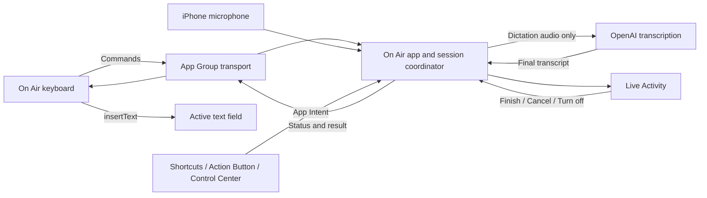

# iPhone internal beta implementation plan

Research checked 30 October 2026. Status: proposed implementation plan; no iOS
application or installable build is included in this PR.

## Outcome and scope

Deliver a native On Air iPhone app to Dan through an internal TestFlight group.
Install its keyboard, speak while writing in another app, finish dictation, and
insert the completed transcript into the intended field. Use On Air's soft red
recording glow and blue finishing waveform in the keyboard area, with recording
status and controls in the Dynamic Island and on the Lock Screen.

Follow Wispr Flow's documented product architecture: a containing app owns the
microphone, a custom keyboard controls dictation and inserts text, and a Live
Activity exposes the session. Wispr demonstrates that this product category is
viable. Device checks below are acceptance checks for our implementation, not a
separate open-ended feasibility project.

The first beta includes:

- iPhone on iOS 18 or later, Swift 6, UIKit keyboard hosting SwiftUI dictation UI
- Dan's own OpenAI API key, explicitly selected for this beta, stored in Keychain
- The existing streaming transcription, retry, British English hints, optional
  dictation notes and conservative version-number formatting
- Basic English QWERTY typing, numbers/punctuation, delete, return and keyboard
  switching, usable without Full Access or a network connection
- Tap to start, finish and cancel; optional Action Button/Shortcuts and Control
  Center entry points; a visible way to turn the entire microphone session off
- A timed ready-session option for repeated dictation without repeated app visits
- Temporary result recovery, content-free diagnostics and internal distribution

Accounts, billing, a managed backend, AI rewriting, persistent dictation history,
on-device speech models, cloud sync, custom dictionaries, iPad-specific layouts,
swipe typing and public App Store publication are later work. The Mac interface
and its hold-fn interaction remain the baseline for regression checks.

## Research findings

### What is established about Wispr

Wispr's setup guide describes installing a keyboard, granting Full Access and
microphone permission, using a mic/start control, and finishing with a checkmark.
Starting from another app can open Flow; return can be automatic or require a
manual swipe. Its current iOS 26.4 guidance explicitly retains that manual
fallback. These are documented behaviours, not evidence of a guaranteed public
API for switching back to any app. [W1], [W2]

Wispr documents Action Button, Back Tap, Shortcuts and Control Center entry
points. Its shortcut route can operate without opening Flow and requires Live
Activities for new recording sessions. [W3]

Its microphone guide says dictation runs in the main app. It distinguishes the
system microphone indicator from a Live Activity that may persist between
dictations, and documents a five-minute default background idle-session timeout.
That does not establish how every version of its internal audio engine works.
We have reviewed public behaviour and documentation, not its proprietary source.
[W4]

### Apple API boundaries

| Area | Evidence and implementation consequence |
| --- | --- |
| Keyboard microphone | Keyboard extensions cannot access the microphone; Full Access does not grant it. Capture belongs in the app. [A1] |
| Full Access | Enables keyboard networking and writing to the App Group. Without it, shared containers can still be read. Our command-writing dictation flow requires it; basic typing does not. [A1] |
| Text input | Use `UIInputViewController` and `textDocumentProxy.insertText`. `documentIdentifier` distinguishes documents, but is not an unrestricted handle for restoring another app's field. [A2], [A3] |
| Background capture | Configure `AVAudioSession` and the app's `UIBackgroundModes = audio` for ongoing recording. This is not a general entitlement to start a microphone from any background callback. [A4] |
| System recording actions | `AudioRecordingIntent` is available from iOS 18 and requires a Live Activity throughout its recording. `LiveActivityIntent` permits the system to run the app process and start an activity without opening its UI. [A5], [A6] |
| Cold activation | A system-invoked recording intent, a foreground app launch and a Darwin notification are different entry points. Directly calling an intent's `perform()` from the keyboard does not transfer execution to the app. Apple DTS also documents restrictions on arbitrary background microphone activation; its cited answer concerns BLE-triggered activation, not a blanket test of every system shortcut route. [A5], [A6], [A7] |
| Opening apps | `NSExtensionContext.open` support depends on the extension point; its documentation does not promise keyboard support. Keyboard launch/return behaviour must have a working manual fallback. [A8] |
| Live Activity UI | Compact/minimal status, expanded controls and Lock Screen presentation are supported. Animation updates are limited to two seconds; the keyboard owns the continuous glow/waveform. [A9], [A10] |
| Compatibility | Secure fields, system-only input types and apps that reject custom keyboards prevent universal coverage. [A11] |
| Review requirements | Basic keyboard input and a keyboard switcher must work without Full Access/networking. Public APIs, appropriate background audio use and clear recording consent/indication remain requirements. An internal beta is not evidence of public App Store acceptance. [A12] |

### Open-source implementations inspected

These are source observations, not device validation or endorsements of every
implementation detail. References are pinned to the commits inspected so later
changes cannot silently change the evidence.

| Project and revision | Useful source evidence | Decision for On Air |
| --- | --- | --- |
| [Dictus](https://github.com/getdictus/dictus-ios/tree/0fd7badf47e1f98f3e3757dc84a2b1d4720d9ed8), MIT | [UnifiedAudioEngine](https://github.com/getdictus/dictus-ios/blob/0fd7badf47e1f98f3e3757dc84a2b1d4720d9ed8/DictusApp/Audio/UnifiedAudioEngine.swift) maintains an input engine and gates sample collection; idle samples are discarded. [DarwinNotifications](https://github.com/getdictus/dictus-ios/blob/0fd7badf47e1f98f3e3757dc84a2b1d4720d9ed8/DictusCore/Sources/DictusCore/DarwinNotifications.swift) signals shared state. [KeyboardState](https://github.com/getdictus/dictus-ios/blob/0fd7badf47e1f98f3e3757dc84a2b1d4720d9ed8/DictusKeyboard/KeyboardState.swift) handles acknowledgement, stale heartbeats and cold-start recovery. | Adopt the separation of capture, session state and keyboard UI, with explicit liveness. Do not assume its URL-opening comments establish API support. Its [HostAppResolver](https://github.com/getdictus/dictus-ios/blob/0fd7badf47e1f98f3e3757dc84a2b1d4720d9ed8/DictusKeyboard/HostAppResolver.swift) uses private UIKit lookup/swizzling; exclude that approach. |
| [Muesli](https://github.com/Muesli-HQ/muesli-ios/tree/66b745bd1e55134de5b0544b01df42559c345767), MIT | [ActionButtonDictationIntent](https://github.com/Muesli-HQ/muesli-ios/blob/66b745bd1e55134de5b0544b01df42559c345767/Muesli/ActionButtonDictationIntent.swift) combines `AudioRecordingIntent` and `LiveActivityIntent`, with `openAppWhenRun = false`. [KeyboardSessionKeeper](https://github.com/Muesli-HQ/muesli-ios/blob/66b745bd1e55134de5b0544b01df42559c345767/Muesli/KeyboardSessionKeeper.swift) uses an input-only engine for a ready keyboard session. | Strong reference for the system-intent route and a shared recording owner. Build the service independently of SwiftUI scene creation so a headless intent can reach it. Source presence alone does not prove cold-start or locked-device reliability. |
| [VocaPhone](https://github.com/VocaHQ/vocaphone/tree/98a7859d635a26dc1cc4f69507d23f33c7c46a1e), AGPL-3.0 | [AudioRecorder](https://github.com/VocaHQ/vocaphone/blob/98a7859d635a26dc1cc4f69507d23f33c7c46a1e/ios/VocaPhoneApp/Audio/AudioRecorder.swift) keeps the same engine for standby and recording. [SharedStore](https://github.com/VocaHQ/vocaphone/blob/98a7859d635a26dc1cc4f69507d23f33c7c46a1e/ios/VocaPhoneShared/SharedStore.swift) uses session revisions to address late writes overriding cancellation. Its [start intent](https://github.com/VocaHQ/vocaphone/blob/98a7859d635a26dc1cc4f69507d23f33c7c46a1e/ios/VocaPhoneApp/App/StartDictationIntent.swift) deliberately opens the app. | Use as an architectural comparison and a source of failure cases; do not vendor its code. Its [URL launcher](https://github.com/VocaHQ/vocaphone/blob/98a7859d635a26dc1cc4f69507d23f33c7c46a1e/ios/VocaPhoneKeyboard/KeyboardURLLauncher.m) traverses responders and invokes selectors; that is not our activation contract. |

The inspected [Dictus licence](https://github.com/getdictus/dictus-ios/blob/0fd7badf47e1f98f3e3757dc84a2b1d4720d9ed8/LICENSE),
[Muesli licence](https://github.com/Muesli-HQ/muesli-ios/blob/66b745bd1e55134de5b0544b01df42559c345767/LICENSE)
and [VocaPhone licence](https://github.com/VocaHQ/vocaphone/blob/98a7859d635a26dc1cc4f69507d23f33c7c46a1e/LICENSE)
are recorded for implementation review. Implement On Air's small native core
without adding these projects as dependencies. If individual permissively
licensed portions are later reused, retain their required notices and inspect
the specific files' licences, including vendored dependencies.

The common architecture is well supported. Automatic app return and cold
microphone activation remain narrower questions than whether an iOS dictation
keyboard can work. We should follow the common architecture and verify those
entry points in the first working build.

## Proposed structure

Add iOS targets to the existing Xcode project, with explicit iOS SDK/platform
settings so they do not inherit the project's macOS SDK assumptions.

| Target/module | Suggested location | Ownership |
| --- | --- | --- |
| `OnAirIOS` app and scheme | `OnAirIOS/App`, `Audio`, `Dictation`, `Onboarding`, `Settings`, `Intents` | Permissions, Keychain, audio engine, transcription, authoritative session coordinator and activity lifecycle |
| `OnAirKeyboard` extension | `OnAirKeyboard/` | Keyboard layout, controls, presentation, destination tracking and final insertion |
| `OnAirActivities` widget extension | `OnAirActivities/` | Live Activity views and Control Center control; app-owned intents for actions |
| `OnAirCore` local Swift package | `Packages/OnAirCore/` | Portable transcription types/client, PCM helpers, notes and version formatting |
| `OnAirVisuals` package target | `Packages/OnAirCore/Sources/OnAirVisuals/` | `GlowFrame`, `GlowRenderer`, envelope and intensity calculations |
| `OnAirIOSShared` module | `OnAirIOSShared/` | Versioned command/status/result contracts and App Group transport |
| iOS tests and input fixture | `Tests/iOS/` | Session/transport tests, app/keyboard tests and controlled text fields |

Keep extension modules extension-safe. Neither the keyboard nor the widget
links the network transcriber, microphone service or credential store.

Extract only portable pieces. `PrototypeController`, global fn monitoring,
`NSPanel`, Accessibility focus restoration, clipboard preservation and Sparkle
stay Mac-specific. `GlowView` currently depends on `PrototypeController`; give
each platform a thin wrapper around the reusable frame/renderer. Replace the
Mac capture implementation on iOS with `AVAudioSession` plus `AVAudioEngine`
and `AVAudioConverter`; preserve the transcriber's 24 kHz mono PCM16 contract.

Inject credentials and notes into the shared transcriber. Remove its implicit
dependency on Mac credential discovery before sharing it. The iOS app does not
import `~/.env`; its Keychain identity is separate from the Mac app's identity.
Preserve the existing Mac Keychain service and preference keys.

## Interaction and recording lifecycle

### Setup

1. Open On Air, explain where dictated audio goes and that ordinary typing is
   not uploaded, then obtain consent for the selected cloud transcription flow.
2. Enter and verify Dan's OpenAI key without recording audio; save it to the
   app's Keychain only after verification succeeds.
3. Request microphone permission in the app following an explicit action.
4. Guide the user through adding On Air in Keyboard Settings and enabling Full
   Access. Confirm `hasFullAccess` from the real keyboard; returning from Settings
   alone is not proof of a grant.
5. Offer a practice field and an actual dictation. Explain Live Activities and
   the optional ready-session behaviour; offer Action Button setup separately.

Do not open the microphone just because setup is complete or the app launches.
Required permissions, key verification and the first real audio buffer are
distinct states. The UI must never claim recording based only on a button tap.

### Start paths

| State/entry point | Behaviour |
| --- | --- |
| Keyboard, app already ready | Save a start command for a new turn, signal the app and wait for acknowledgement plus confirmed capture. Stay in the host app. |
| Keyboard, app inactive or unresponsive | Show activation guidance after a bounded acknowledgement window. Investigate a normal user-triggered URL/open action, but do not rely on extension URL opening being supported. The guaranteed fallback is to open On Air or use its system shortcut/control, activate the session, and return manually. |
| Action Button, Shortcuts, Control Center | System-invoked `AudioRecordingIntent` plus `LiveActivityIntent` starts/toggles a turn through the same coordinator. Create the required activity before capture. Test cold, suspended and warm starts independently. Offer a foreground `AppIntent` fallback when activation fails. |
| App | Start directly from an explicit tap. Show recording and concise return guidance while capture continues in the background. |
| Recording/finishing | A second start never creates another engine or queues a future recording. Finish/cancel are idempotent; starts during finalisation are ignored with visible busy state. |

Use a proposed 750 ms warm-start acknowledgement window, a ten-second expiry
for an unfulfilled activation request and a separate capture-start deadline.
Tune these from measured device behaviour. An opening-URL completion is not an
audio acknowledgement. Expired requests cannot unexpectedly start recording on
a later app launch. A foreground fallback requires a new user action if its
original request has expired. The initial fallback may activate a ready session
in the app and ask for a fresh mic tap after returning to the keyboard, establishing
the destination there. Do not silently redirect an old request to a new field.

No private host-app bundle lookup, responder-chain `UIApplication` invocation,
private suspension/back-navigation API, silent audio loop or simulated call is
part of the beta. Automatic return is an optional future refinement after a
supported path is established; manual return must work in the first beta.

### Ready sessions

Provide an explicit **Keep ready for 5 minutes** option, with **Turn off after
each dictation** as the alternative. Explain that ready mode can keep the
microphone active and the orange system indicator visible. A ready session is
not the same as capturing a dictation for transcription.

In ready mode, keep one input engine running and discard buffers while no turn
is recording. No idle audio enters the retry buffer, socket or shared container.
An explicit enable action starts the session; completing onboarding or restoring
a preference does not. Use **Ready — microphone active** in the expanded status,
and **Listening** only while collecting a turn.

Expire readiness five minutes after the last completed/cancelled turn or initial
activation, even if the keyboard remains visible. Do not interrupt an active
turn at the idle deadline; give it its own five-minute recording cap. A new user
start refreshes the session. Provide **Turn off On Air** in the app and expanded
activity to stop the engine immediately. There is no unlimited-ready setting in
the first beta.

This follows the open-source ready-engine pattern, with a deliberately bounded
beta policy. Measure its energy cost and validate background-audio suitability;
competitor availability does not establish approval for our precise behaviour.

### Capture, finish and interruption

- Use one process-wide coordinator reachable from app launch and system intents,
  independent of any SwiftUI view's `onAppear`. Serialise all state transitions.
- Configure a recording-capable audio session; test playback mixing and Bluetooth
  policy on the actual device. Convert the hardware's negotiated format rather
  than assuming its sample rate is 24 kHz.
- Keep the realtime tap bounded: copy into a bounded queue, then convert, meter
  and send on a worker. No file I/O, networking or large allocations in the tap.
- Finish closes the turn's audio gate immediately. In per-dictation mode it also
  stops/deactivates the engine; in ready mode it discards subsequent input.
- Retain the existing final-only transcription policy and 20-second completion
  deadline. Request bounded background completion time before stopping audio;
  its expiration handler must cancel work safely. A Live Activity does not itself
  grant arbitrary network runtime. Never extend microphone use just to finish a
  network request when the user chose per-dictation mode.
- Keep a single failed clip in memory for up to five minutes, bounded to the
  five-minute recording cap (about 14.4 MB of PCM16 before other overhead). Retry
  never opens the microphone. Clear audio on success, cancellation, a new turn,
  protected-data unavailability or process exit. Memory pressure may remove retry
  availability; do not promise recovery after process termination.
- Calls, Siri, route loss and media-services resets stop or interrupt the turn.
  Preserve already-captured audio for an explicit retry when safe, and show a
  recoverable state. Do not silently resume recording after an interruption.
- Force-quit, stale heartbeat, activity dismissal, session expiry and permission
  revocation must converge on off/interrupted states, not a permanent listening UI.
- Locked-device starts are outside beta acceptance; require authentication for
  start actions. Do not display transcript content on the Lock Screen. Exercise
  ongoing-recording lock/unlock behaviour explicitly and stop/clear sensitive
  work when protected data becomes unavailable.

## Cross-process transport and insertion

Use an App Group for small, versioned messages and Darwin notifications as
payload-free nudges. A notification neither guarantees delivery nor launches a
suspended app. Reconcile on keyboard appearance, app activation and bounded
polling while a session is active. Keep ordinary settings in shared defaults;
do not use independent defaults writes as a transaction protocol.

Define `SessionSnapshot`, `DictationCommand`, `TranscriptResult` and
`InsertionReceipt` contracts. Include schema version, process/session generation,
turn UUID, command/result UUID, monotonic revision, phase, timestamps/expiry and
fixed failure codes. Meter data contains only a normalised level and freshness,
not audio. Publish levels at roughly 10 Hz and interpolate locally for animation.

The app is the single writer of authoritative session state. Each sender writes
immutable command records atomically; the app processes and acknowledges them
serially. Validate size, schema, generation and expiry before acting. Duplicate
notifications and retries must not restart audio or apply a command twice. A
cancel invalidates the turn so late permission, connection and transcript
callbacks cannot resurrect it. Any small cross-process claim/lock must fail
closed on timeout and never remain held across an `await`.

Separate audio-buffer freshness from session/process freshness. After capture
stops, missing meter updates are expected; finalisation is governed by its own
deadline. A saved ready flag or an old turn's heartbeat is never proof that a
new turn is recording.

Insertion rules:

1. At start, the keyboard captures its own instance generation, the proxy's
   `documentIdentifier` and a local edit/selection generation. Keep any necessary
   context checks in memory; never send surrounding field content to the app or
   transcription provider.
2. Insert only a completed, formatted result for that turn, while the keyboard
   is visible and the same destination is still verifiable. Treat keyboard
   typing, selection moves and host text changes conservatively. Test callbacks
   generated by our own insertion so they do not create false invalidations.
3. Unrelated app switching, keyboard replacement/recreation, changed fields or
   uncertain context invalidate automatic insertion. For a deliberate activation
   handoff, revalidate the original document and selection before rearming
   automatic insertion; otherwise require explicit delivery. iOS does not provide
   the Mac's Accessibility restoration mechanism. Offer **Insert transcript** in
   the current keyboard or **Copy** in the app when verification fails.
4. Record a one-use claim before `insertText` and a receipt afterwards. The field
   mutation and receipt cannot form an atomic transaction across processes. If
   the extension dies between them, show uncertain delivery for manual recovery;
   never blindly auto-insert a second time. This is at-most-once automatic
   delivery, not a promise of exactly-once delivery through a crash.
5. Clipboard writes occur only for an explicit Copy action, never as the normal
   keyboard insertion transport. A result cannot be delivered automatically by
   both a shortcut and the keyboard.

Unlike the Mac's in-memory handoff, an App Group result file briefly persists
text on disk. State this explicitly in the iOS privacy description. Use protected
files, exclude the transport directory from backup, and retain results for at
most five minutes of usability. Delete consumed/cancelled results immediately;
reject expired results on every read and purge leftovers whenever either process
next runs. iOS suspension means physical deletion at the exact expiry instant
cannot be guaranteed. Do not persist raw audio, credentials, field contents or
clipboard data in the shared container.

## Keyboard and activity presentation

The normal surface is a small native typing keyboard with a prominent dictation
control. Recording replaces the keys with the dedicated lower-screen panel from
the reference: cancel at the upper left, finish at the upper right, status in the
centre, and On Air's glow along the bottom. Respect the system's keyboard bounds
and `needsInputModeSwitchKey`; do not draw over the host application's content.

| State | Keyboard | Live Activity |
| --- | --- | --- |
| Off/activation required | Mic control and clear activation/setup guidance | Ended |
| Ready | Quiet ready label; no speech-reactive animation | Compact On Air symbol; expanded microphone-active status and Turn off |
| Starting | Immediate pressed feedback and Starting label | Starting, only once an activity actually exists |
| Recording | Soft red voice-reactive glow, elapsed time, Cancel and Finish | Listening and system-rendered elapsed timer; expanded Finish/Cancel/Turn off |
| Finishing | Smooth transition to blue travelling waveform | Finishing; no invented progress percentage |
| Delivered | Brief confirmation, then ready/typing | Ready if the session remains enabled; otherwise end |
| Undelivered/error | Explicit Insert, Retry or setup recovery as applicable | Short content-free state; never dictated text |

Reuse the existing renderer with keyboard-specific scaling rather than shrinking
the 1080p-authored geometry blindly. Use approximately 200–300 ms interruptible
transitions, live audio levels while recording, and a distinct finishing wave.
Pause rendering when the keyboard is hidden. Reduce Motion uses static colour
and opacity changes; VoiceOver labels and announcements communicate every state.
Test light/dark appearances, large text, landscape and a small iPhone screen.

The activity is an ActivityKit/WidgetKit feature, not a push notification. Use a
static recording symbol, timer and bounded state transitions in the island.
Provide compact, minimal, expanded and Lock Screen layouts. Expanded and Lock
Screen actions route to the same coordinator and carry the session/turn ID.
Stale actions cannot stop or restart a later session. End stale/orphaned
activities after app restart, and observe activity dismissal to release a ready
microphone session. The foreground app remains usable when Live Activities are
disabled; system-intent recording that requires an activity fails before capture.

## Credentials, diagnostics and privacy

Use a dedicated iOS Keychain service with device-only, unlocked access. Only the
main app reads the key. The keyboard receives readiness/error categories, never
the key, its plaintext draft, or authenticated requests. Removing the key cancels
pending verification and disables new dictation; changing notes/key waits for a
safe session boundary. Never embed a provider key in the binary or CI secrets.

Keep the existing OpenAI transport/model configuration initially; confirm its
iOS networking and account compatibility during implementation. No new provider
account or backend is required. Ordinary keyboard input, selected text and field
context must not be sent to OpenAI. Privacy copy must distinguish local data
handling from the transcription provider's policy; do not claim audio stays on
the phone or that a provider retains nothing without verifying that policy.

Use opt-in local diagnostics with fixed reason codes, phase transitions, durations,
counts and random session IDs. Exclude dictated text, audio, field/clipboard
contents, window/app titles, credentials, response bodies and arbitrary error
descriptions. Do not export diagnostics automatically. PR evidence uses synthetic
phrases and controlled fields; TestFlight screenshots/feedback can contain user
content and must be reviewed before being copied into public issues or PRs.

Add privacy manifests for the app/extensions and review required-reason APIs and
App Store Connect data declarations against the implementation. No analytics SDK
is needed for the internal beta.

## Signing, versioning and internal distribution

Use the existing Apple team `R2GGK3VN2C`, subject to verifying its current Developer
Program and App Store Connect access. Suggested identifiers, to register after
checking availability:

| Item | Identifier |
| --- | --- |
| App | `com.danbarclay.onair.ios` |
| Keyboard | `com.danbarclay.onair.ios.keyboard` |
| Widget/Live Activity | `com.danbarclay.onair.ios.activities` |
| App Group | `group.com.danbarclay.onair.ios` |

Create explicit identifiers, App Group assignments and provisioning profiles for
all three targets, plus an iOS App Store Connect app record. Use Apple Development
for direct device installation and Apple Distribution/App Store Connect for
TestFlight. The existing Developer ID certificate and notarized DMG pipeline do
not distribute this iPhone app. [A13], [A14]

Create an internal TestFlight group with Dan as an eligible App Store Connect
user. Select internal-only distribution, disable public links/external groups,
and do not submit an App Store release. Builds expire after 90 days. An internal
tester must have app access in App Store Connect; an arbitrary email invitation
alone does not make someone an internal tester. [A13], [A14]

Add a separate, manually dispatched **Release On Air iOS Beta** workflow for a
trusted PR branch. Use a dedicated protected signing environment, temporary
keychain, distribution certificate/profiles and appropriately scoped App Store
Connect upload credentials. Existing notarization credentials are not assumed
to have the required upload rights. Never run signing jobs for untrusted forks.

Archive the exact tested commit, validate the app and embedded extensions, export
and upload it, wait for Apple processing, then assign the processed build to the
internal group. Record source SHA, version/build, target IDs, SDK/Xcode version,
entitlements, archive/export checksums and the App Store Connect build identifier
in the build manifest. These checksums describe our exported artifacts, not an
Apple-reprocessed installation. Confirm installation from TestFlight and retain
the build/run links in the implementation PR. Do not call upload alone delivery.

This planning PR changes no application version and needs no binary release.
At research time the latest published Mac release is `1.0.8`; open PR #28 proposes
`1.0.9`. A first feature release could use `1.1.0`, but choose an unused version
only when implementation begins, after rechecking releases, pending versioned
PRs and App Store Connect. Align Debug/Release marketing versions and all iOS
extension versions with their containing app. Use an increasing iOS workflow run
number for build versions; never reuse a processed build number for changed
binaries or an upload rerun that rebuilds them.

Shared-code/Xcode changes that affect the Mac must still follow
[RELEASING.md](RELEASING.md): relevant Mac checks, the chosen version in both
configurations and a signed/notarized **Release On Air** preview with
`publish=false`. Keep both platform previews unpublished while their PR is open.
Public release tags continue to point to tested commits on main. Update release
documentation and path filters when the new package and iOS workflows land; a
shared-package change must trigger both platforms' relevant checks.

## Implementation sequence

Each implementation PR includes its behaviour, validation evidence and remaining
device limitations. Use screenshots for layout and video for motion/interaction,
with synthetic content. Merge decisions remain with Dan.

| Step | Concrete work | Completion evidence |
| --- | --- | --- |
| 1. App and keyboard foundation | Add targets/schemes, App Group contracts, Keychain setup, portable core extraction and a basic keyboard. Add an input-fixture app. Start signing/account setup in parallel with coding. | Simulator launch/typing; package checks; Mac regressions after extraction; first development-signed installation on Dan's iPhone |
| 2. First complete dictation | Add the single audio/session coordinator, streaming client integration, foreground start/manual return, keyboard Finish/Cancel, final insertion and Live Activity. Include a functional activation fallback from the beginning. | A real-device recording from start through correct-field insertion; cancellation ends capture; a second turn works; source/build recorded |
| 3. Repeated dictation and system actions | Add timed ready mode, system recording intents, Control Center, Action Button setup, acknowledgements, stale-session handling and bounded completion/retry. | Cold/warm/relaunched entry-point matrix, microphone release and interruption evidence; explicit fallback for any unsupported path |
| 4. On Air presentation and hardening | Adapt glow/waveform, accessibility, basic typing polish, destination invalidation, one-use insertion, temporary recovery, privacy manifests and content-free diagnostics. | Animation video and light/dark/Reduce Motion captures; transport/cancellation/insertion regressions; resource measurements |
| 5. Internal TestFlight beta | Add the iOS archive/upload workflow, register final identifiers/profiles, create the internal group, upload the exact tested commit and install the processed build. Update testing/release docs. | Dan can install/update from TestFlight, finish setup and dictate in the selected apps; build links and known limitations are in the PR |

The first vertical slice is useful even if cold shortcut activation needs a
foreground fallback. Do not delay the internal beta for public-launch extras,
an unlimited ready mode or automatic return to arbitrary apps.

## Validation and beta acceptance

### Automated checks

- Shared-core tests: PCM/WAV framing, final-only results, formatter behaviour,
  cancellation/deadline handling and injected configuration
- Session tests: duplicate/late commands, cancellation during start, outdated
  generations, readiness expiry, missing acknowledgements, audio interruption,
  activity dismissal and expired background completion time
- Cross-process tests using separate fixture processes where appropriate: atomic
  writes, rejected oversized/malformed records, lost notifications, stale
  revisions, conflicting finish/cancel and lock/claim failure
- Insertion tests: changed document/selection, host edits, keyboard replacement,
  duplicate result delivery and crash between claim/insertion/receipt
- Privacy tests: idle audio never reaches transport, raw audio never reaches
  disk, keys stay out of the App Group, expiry checked on reads, expired files
  purged on next execution and synthetic private markers absent from logs
- Simulator UI checks: setup states, typing without Full Access/network, globe
  switching, recording presentation from injected states, recoverable errors,
  large text, VoiceOver labels and Reduce Motion
- Mac checks from [TESTING.md](TESTING.md) when extracting or changing shared
  code; keep the existing visual baselines and fn/clipboard behaviour
- Signing/archive checks: app and extension IDs, matching versions/builds,
  deployment targets, provisioning, App Group entitlements and exclusion of
  test-control code from distributable targets

### Physical-device checks

Record exact hardware, OS, app version/build and source commit. Simulator results
cannot establish microphone permissions, background lifetime, audio routes,
system-intent execution, energy use or TestFlight signing correctness.

| Scenario | Required observation |
| --- | --- |
| Fresh install and upgrade | Keyboard appears, each permission is checked, the key is verified and retained across upgrade, and nothing records before a user action |
| Host compatibility | Messages, Notes, Mail, Safari text inputs and Slack; include plain/multiline fields and a controlled web editor; record unsupported cases explicitly |
| Warm sessions | At least 20 consecutive turns across multiple fields/apps; no repeated app visit while readiness is healthy; no duplicate or wrong-field insertion |
| Cold/recovery starts | App never launched, foreground, suspended, force-quit, rebooted and terminated under memory pressure; correct activation/fallback without phantom recording |
| Entry points | Keyboard, app, Action Button where available, Shortcuts and Control Center; all use one recording owner and stop the same turn |
| Audio | Built-in mic and AirPods; connect/disconnect, calls, Siri, competing audio, route changes and media reset; no silent auto-resume |
| Network | Wi-Fi/cellular transitions, offline start, drop during speech/finalisation, rejected key and timeout; bounded recovery with no partial insertion |
| Destination changes | Type, move the cursor, select text, change fields/apps or switch keyboards during speech/finalisation; uncertain results require explicit insertion |
| Privacy and lifecycle | Ready audio discarded, Turn off/expiry clears the mic indicator, lock/unlock and revoked permissions handled, no transcript on the Lock Screen |
| Presentation | Dynamic Island and Lock Screen state match actual capture; a non-island device uses the Lock Screen layout; reduced motion and large text remain usable |
| Resources | Measure ten-minute ready/off windows and repeated 10/30/60-second dictations; record energy/memory and latency, with no unbounded queue or steady memory growth |
| Distribution | Install the processed internal TestFlight build, repeat the main dictation path and upgrade to the next build without losing setup/key |

Target immediate touch feedback and measure first-buffer and finish-to-insert
latency separately. Around one second after finishing is an initial product
goal, not a claim about measured iPhone or network performance. Start/stop honesty,
no unintended capture, and correct insertion take precedence over a latency goal.

The beta is ready for Dan when the TestFlight installation and primary dictation
path work on his device, the core interruption/cancellation/insertion cases pass,
and any untested devices or fallback-only entry points are recorded. Wider device
coverage and public App Store review remain later release work.

## Inputs to confirm during implementation

- Dan's iPhone model and iOS version, including Action Button availability
- Existing Apple team membership, App Store Connect role and identifier availability
- The exact cold-start/system-intent behaviour on that device and minimum OS
- Ready-session battery cost and suitability for the eventual public release

These do not block this plan. Use iOS 18+, the existing team and the explicit
five-minute ready option as implementation defaults, and adjust from evidence.

## Sources

Wispr behaviour:

- [W1 — Keyboard setup][W1]
- [W2 — iOS 26.4 return behaviour][W2]
- [W3 — iPhone shortcuts][W3]
- [W4 — Microphone/session indicators and timeout][W4]
- [App Store listing supplied for this project](https://apps.apple.com/us/app/wispr-flow-ai-voice-keyboard/id6497229487)

Apple APIs and distribution:

- [A1 — Configuring keyboard Full Access][A1]
- [A2 — Creating a custom keyboard][A2]
- [A3 — Text document identity][A3]
- [A4 — Audio recording and background mode][A4]
- [A5 — AudioRecordingIntent][A5]
- [A6 — LiveActivityIntent][A6]
- [A7 — Apple DTS on arbitrary background audio activation][A7]
- [A8 — Extension URL opening][A8]
- [A9 — Live Activities][A9]
- [A10 — Widget and Live Activity animation limits][A10]
- [A11 — Custom keyboard restrictions][A11]
- [A12 — App Review Guidelines, especially 2.5 and 4.4.1][A12]
- [A13 — TestFlight overview][A13]
- [A14 — Internal testers and internal-only builds][A14]

[W1]: https://docs.wisprflow.ai/articles/7453988911-set-up-the-flow-keyboard-on-iphone
[W2]: https://docs.wisprflow.ai/articles/6269634092-adapting-to-ios-26-4
[W3]: https://docs.wisprflow.ai/articles/1986921789-how-to-set-up-flow-shortcuts-for-iphone
[W4]: https://docs.wisprflow.ai/articles/3634682593-why-the-orange-dot-or-mic-indicator-stays-on-after-dictating-ios
[A1]: https://developer.apple.com/documentation/uikit/configuring-open-access-for-a-custom-keyboard
[A2]: https://developer.apple.com/documentation/uikit/creating-a-custom-keyboard
[A3]: https://developer.apple.com/documentation/uikit/uitextdocumentproxy/documentidentifier
[A4]: https://developer.apple.com/documentation/avfaudio/avaudiosession/category-swift.struct/record
[A5]: https://developer.apple.com/documentation/appintents/audiorecordingintent
[A6]: https://developer.apple.com/documentation/appintents/liveactivityintent
[A7]: https://developer.apple.com/forums/thread/816408
[A8]: https://developer.apple.com/documentation/foundation/nsextensioncontext/open(_:completionhandler:)
[A9]: https://developer.apple.com/documentation/activitykit/displaying-live-data-with-live-activities
[A10]: https://developer.apple.com/documentation/widgetkit/animating-data-updates-in-widgets-and-live-activities
[A11]: https://developer.apple.com/library/archive/documentation/General/Conceptual/ExtensibilityPG/CustomKeyboard.html
[A12]: https://developer.apple.com/app-store/review/guidelines/
[A13]: https://developer.apple.com/help/app-store-connect/test-a-beta-version/testflight-overview/
[A14]: https://developer.apple.com/help/app-store-connect/test-a-beta-version/add-internal-testers/
